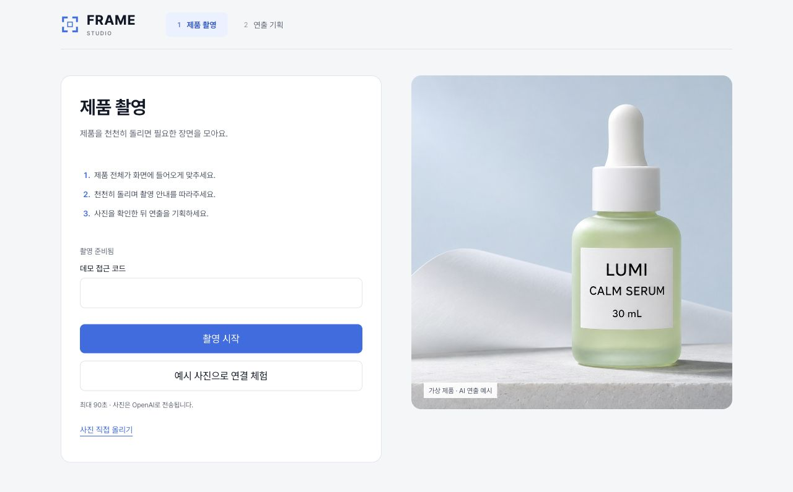
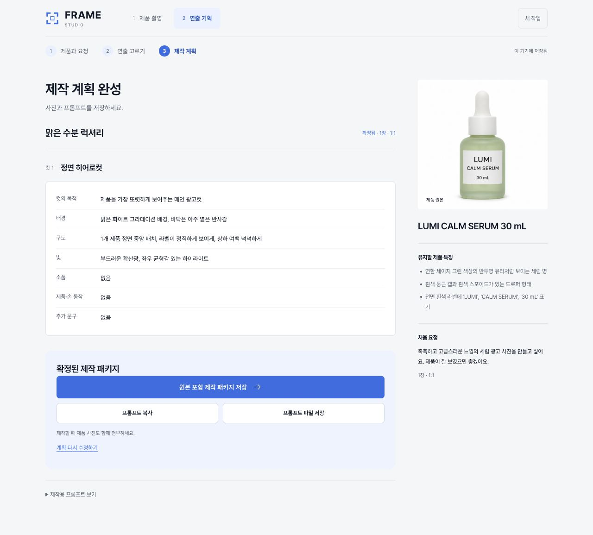

# FRAME Studio

[촬영 시작](https://frame-prompt-demo.vercel.app/capture) · [바로 연출 기획](https://frame-prompt-demo.vercel.app/prompt)

제품 촬영과 연출 기획을 하나로 연결한 웹앱입니다. 영상 전체에서 누적한 관찰 정보와 근거를 다시 업로드하지 않고, 원하는 느낌을 입력해 제작 계획을 만들 수 있습니다.

- `/capture`: 기준 정면·회전 안내, 전체 영상 해독/시간구간 분석, 원본 세부 검증, 누적 관찰 기록과 보충 영상 연결
- `/prompt` (또는 `/`): 직접 사진 업로드 또는 촬영 사진 연결, 연출 방향 제안, 빠진 실물 근거가 있을 때만 확인 질문, 항목별 수정, 확정·내보내기
- 촬영 사진 연결은 같은 브라우저/도메인의 IndexedDB를 사용합니다. 기존 기획은 자동으로 덮어쓰지 않습니다.
- 카메라 없이 저장된 MOV/MP4/WebM 영상을 불러올 수 있습니다. 한 영상 3분·200MB 이내입니다.

## 실행

Node.js 22.15 이상(테스트의 `registerHooks` 지원 필요) 또는 Node.js 24 LTS를 사용하세요.

```sh
npm ci
cp .env.example .env.local
npm run dev
```

`.env.local`에 `OPENAI_API_KEY`를 설정하세요. API 키는 서버에서만 사용하며 데모 접근 코드는 요구하지 않습니다. 배포 환경에서도 같은 서버 환경 변수를 설정해야 합니다. 기본 모델은 `gpt-5.4-mini`이며 `PROMPT_MODEL`, `CAPTURE_MODEL`로 변경할 수 있습니다.

```sh
npm test
npm run typecheck
npm run build
```

## 프롬프트 보완

고객의 원문에서 필수 편집·색상·문구·구도 조건을 분리하고, 제안한 모든 연출과 최종 프롬프트에 남는지 검사합니다. 이미 있는 사진을 다시 요구하거나 일반 모델·손·조명 때문에 질문을 추가하지 않습니다. 원문은 최대 12,000자, 원본 사진은 24장, 출력 계획은 12컷까지 지원합니다. 일시적인 모델 오류에는 제한된 재시도를 적용하며 실패해도 입력과 기존 기획을 유지합니다.

## 데이터 흐름

1. 원본 전체 영상을 기기에 보관합니다. WebKit 호환성을 위해 원본 바이트를 변환 없이 ArrayBuffer로 저장합니다.
2. 모든 프레임을 해독하고 프레임 수·시간 범위를 감사합니다. 연속 48프레임의 묶음을 빠짐없이 OpenAI에 전달하며, 발견한 부위는 원본 해상도로 다시 검증합니다.
3. 구간별 관찰·미확인 부위·원본 위치를 누적하고 보충 영상도 같은 기록에 이어 붙입니다. 실패한 구간부터 재개할 수 있습니다.
4. 연출 기획에는 누적 관찰 전체의 텍스트/시각/품질/구성 상태와 대표 근거 사진을 함께 전달합니다. 기존 기획이 있으면 가져오기 전에 선택합니다.
5. 원본 영상, 영상 분석 근거 JSON, 승인한 제작 계획을 내보낼 수 있습니다. 원본 동영상은 서버에 보관하지 않습니다.

설계·제한·검증 방법은 [전체 영상 엔진 문서](docs/whole-video-engine.md)를 참조하세요. 전체 시간구간 처리는 모든 물리적 면이나 모든 의미의 인식 성공을 보증하지 않습니다.

사진과 기획은 이 브라우저에 남습니다. 다른 기기와의 동기화, 다중 사용자 계정, 3D 복원, 최종 광고 이미지 생성은 구현되어 있지 않습니다. 브라우저 저장 공간을 지우면 로컬 자료도 삭제됩니다.

## 구조

- `app/capture`, `lib/video-capture`: 전체 영상 엔진 (`lib/capture`는 기존 공통 표시/유틸리티)
- `app/prompt`, `lib/prompt-engine`: 프롬프트 제안 엔진과 연결 계약
- `app/api`: 요청 검증·AI 호출
- `app/studio-nav.*`, `DESIGN.md`: 통합 UI
- `tests`: 합성 데이터 기반 검사. 실제 고객 자료는 포함하지 않습니다.

촬영의 새 정보/같은 제품/보충 여부는 AI 추정이며 제품 전체 확보율이 아닙니다. 라벨 일치와 실제 제작 품질은 결과물에서 별도 검수가 필요합니다. 요청 수 제한은 서버 인스턴스별 최선 노력 방식이며, 운영 규모의 계정별 사용량 제한은 별도 구현이 필요합니다.

## 브라우저 검증 스크립트

`scripts/verify-*.mjs`는 개발용 Playwright 검사입니다. 별도로 설치한 `playwright` 패키지 또는 `PLAYWRIGHT_MODULE` 경로를 사용합니다. 실제 영상을 사용하는 검사는 `VALIDATION_VIDEO_PATH`를 지정해야 하며, Chromium 실행 파일을 직접 지정하려면 `CHROME_EXECUTABLE_PATH`를 사용합니다. 스크립트별 로컬 포트/기존 검증 기록 의존성을 확인한 뒤 실행하세요. 고객 원본과 `artifacts/` 결과는 Git 및 배포에서 제외합니다.

## 화면




